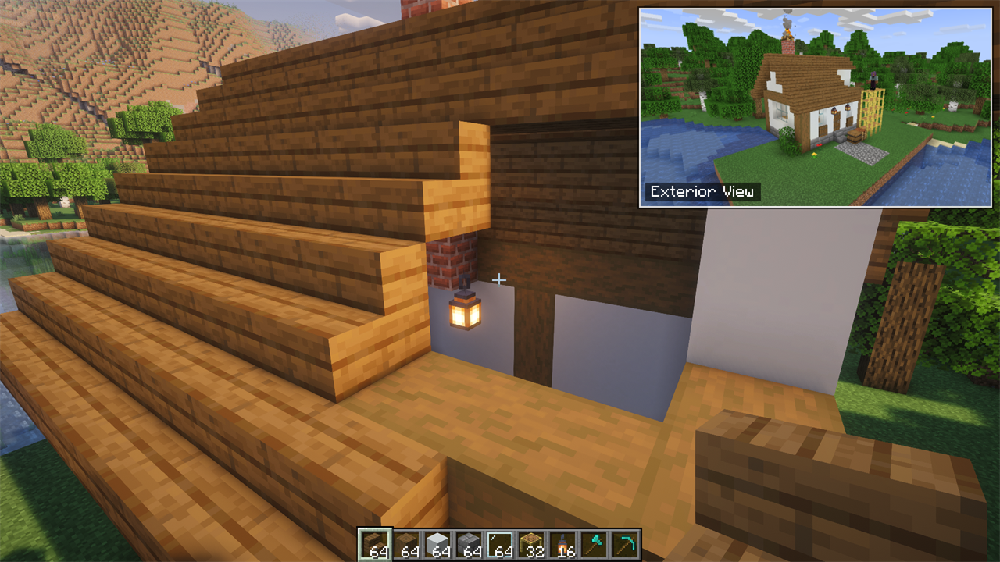
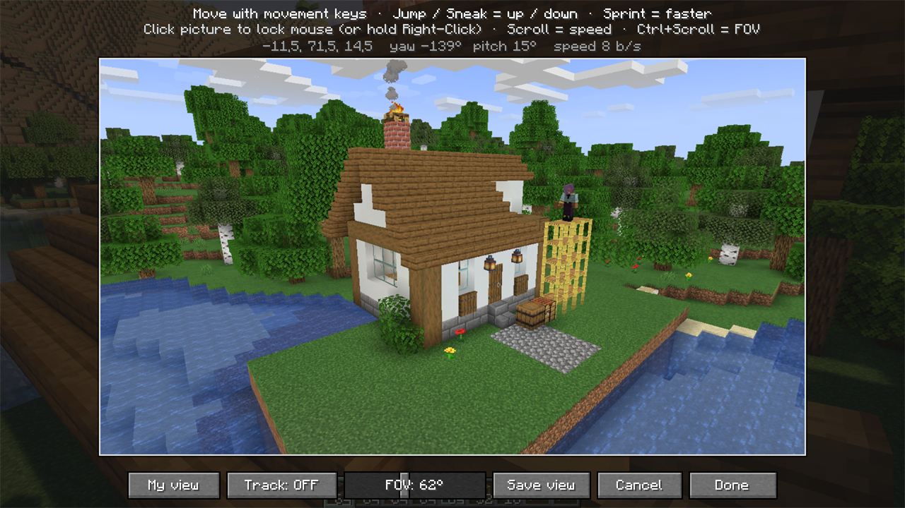

# PiP Camera

A **client-side** Minecraft **1.21.1 (NeoForge)** mod that lets you pin a live picture-in-picture (PiP) external camera onto your HUD while you continue playing and building normally in first person.

Designed for builders and technical players who want to watch their build, farm, or contraption from the outside without constantly toggling freecam — with **zero required mod dependencies** and **no server-side installation needed**.


*Building up close in first person (with Iris + Complementary shaders) while watching the full exterior live in the top-right PiP window.*

---

## Features

- **Built-in Fly Camera Placement** — Position your camera using your normal movement keys and mouse (click to lock cursor or hold Right-Click to look), scroll to adjust flight speed, `Ctrl + Scroll` to adjust FOV, and **Cancel** to revert changes.
- **Track Player Mode** — Leave the camera pinned like a tripod while it automatically turns to keep your character centered as you move around and build.
- **Customizable HUD** — Open **Move HUD…** to drag the live PiP window anywhere on screen (with soft edge snapping and scroll-to-resize), snap to any corner, choose between `16:9`, `4:3`, and `1:1` aspect ratios, and toggle the border frame and label badge.
- **Hold-to-Peek** — Bind an optional key to temporarily expand the PiP large and centered while held.
- **Saved Camera Views** — Save, rename, update, delete, and cycle through multiple named camera angles per singleplayer world or multiplayer server.
- **Independent Performance & Visual Controls** — Tune internal render resolution (`320`–`1920`px), update rate (`1`–`60` FPS), view distance (`2`–`32` chunks), FOV (`20°`–`120°`), lighting override (`Auto` / `Day` / `Night`), and weather/cloud visibility in the PiP.
- **Client-Side Chunk Retention** — Optionally keep already-visited chunks around your pinned camera visible after walking out of server view distance (purely client-side; frozen at their last known state until you return).
- **Standalone & Modpack-Friendly** — Requires only Minecraft 1.21.1 and NeoForge 21.1+, with built-in optional compatibility bridges for popular rendering and content mods.

---

## Installation

1. Install **Minecraft 1.21.1** with **NeoForge 21.1.0+**.
2. Drop `pipcam-<version>.jar` into your client's `mods/` folder.
3. Launch the game. No server-side installation is required; you can join vanilla or modded servers freely.

---

## Controls & Usage

Only **one** key is bound by default so it stays out of the way of large modpacks. All other shortcuts are optional and configurable under **Options → Controls → PiP Camera**:

| Action | Default |
|---|---|
| Open PiP camera menu | `O` |
| Show / hide PiP window | Unbound |
| Pause / resume PiP updates | Unbound |
| Hold to expand PiP (Peek) | Unbound |
| Pin PiP camera at my view | Unbound |
| Place / move PiP camera | Unbound |
| Toggle track player | Unbound |
| Next / Previous saved view | Unbound |

Everything is also accessible via the **PiP Camera** menu (`O`) or **Mods → PiP Camera → Config**.

### Placement Screen Controls
- **Move:** Your normal movement keys (`WASD`), Jump / Sneak (up / down), Sprint (4× speed)
- **Look:** Left-click the preview to lock the cursor (click or `Esc` to release), or **hold Right-Click** on the preview to look around
- **Speed / FOV:** Scroll wheel adjusts flight speed; `Ctrl + Scroll` adjusts FOV



---

## Configuration

Settings, active pinned cameras, and saved views are persisted automatically to:

```text
config/pipcam.json
```

Pinned cameras and saved views are stored per singleplayer save folder and per multiplayer server address.

---

## Mod Compatibility

Requires **no other mods**. When the following optional mods are present, PiP Camera activates lightweight compatibility hooks automatically:

- **Sodium** (`0.8.x`) — Spatial section search for detached cameras and chunk shader patching when paired with Iris shader packs.
- **Iris Shaders** (`1.8.x`) — Keeps your shader pack running in the main view while rendering the PiP cleanly through the unshaded vanilla pipeline (no shader reloads, no main-view TAA ghosting, and restored directional face shading on terrain).
- **Distant Horizons** (`3.3.x`) — Isolates DH post-processing/TAA state and transfers LOD depth into the PiP so distant terrain renders without flickering or corrupting the main view.
- **Create / Flywheel / Colorwheel** (`6.0.x` / `1.0.x` / `1.3.x`) — Falls back to Create's built-in vanilla renderers during the PiP pass when Colorwheel's Iris backend is active, so cogwheels, shafts, belts, fans, and contraptions render in the PiP while leaving Colorwheel untouched in the main view.
- **Veil / Sable** (`4.3.x` / `2.0.x`) & **Create Deep Seas** — Preserves Veil camera matrices and prevents shared water-occlusion masks from leaking into the PiP.

### Known Limitations
- **Unshaded PiP when using Iris:** By design, the PiP renders through the lightweight vanilla pipeline instead of running a second full shader/shadow pass, keeping frame rates playable and VRAM low.
- **Chunk retention is read-only/frozen:** Chunks retained after walking away reflect their last received state until you move back into range and the server sends updated chunk packets.
- **Mod internals:** Optional hooks for Iris, Distant Horizons, and Colorwheel rely on specific rendering internals tested on the versions listed above; if an incompatible update changes those internals, each bridge fails safely and logs a warning without crashing the game.

---

## Building from Source

Requires **Java 21**. No local jars or third-party Maven repositories are required.

```bash
./gradlew build
```

The compiled mod JAR is output to `build/libs/pipcam-<version>.jar`.

---

## License & Credits

Licensed under the **MIT License** — see [LICENSE](LICENSE).

Portions of the offscreen level-rendering state backup/restore flow in `PipLevelRenderer` were adapted from FoundryMC's [Veil](https://github.com/FoundryMC/Veil) (`VeilLevelPerspectiveRenderer`), licensed under the MIT License.
